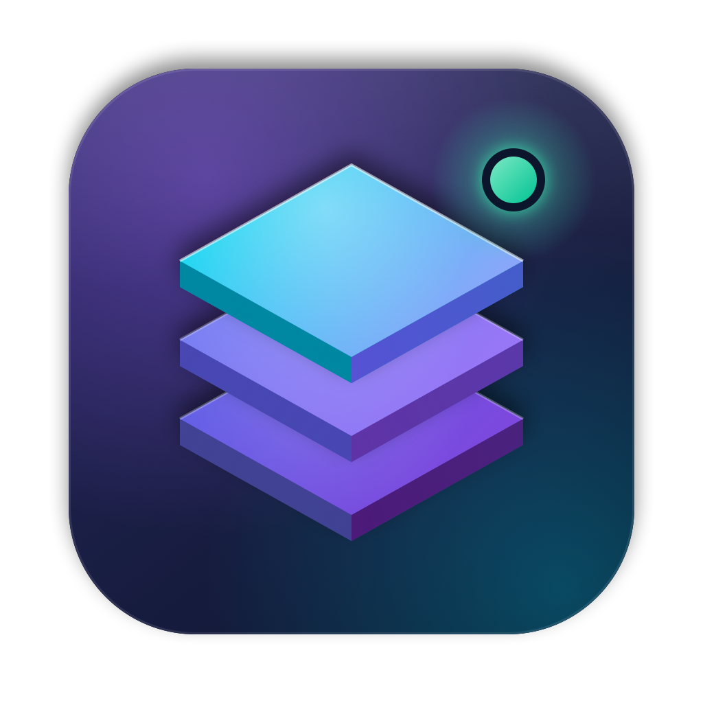
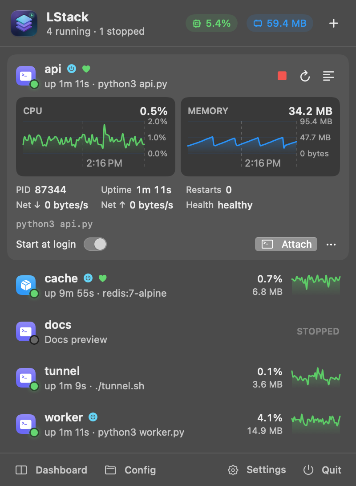
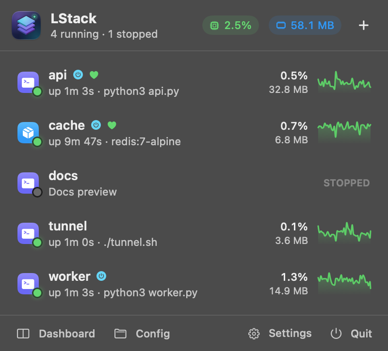
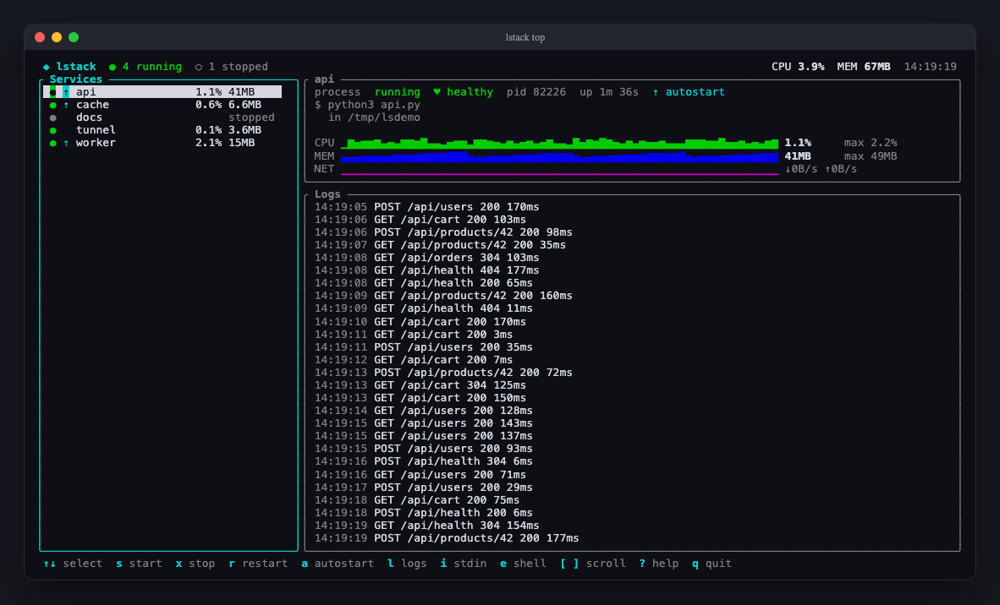
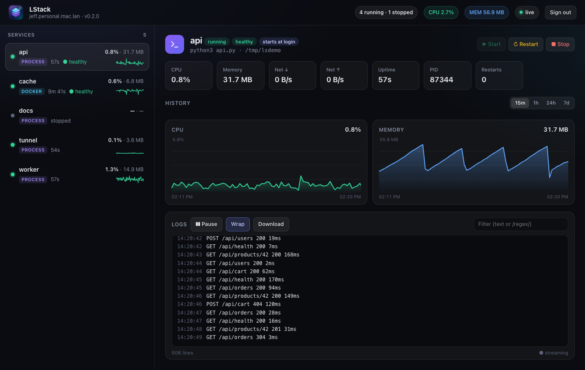
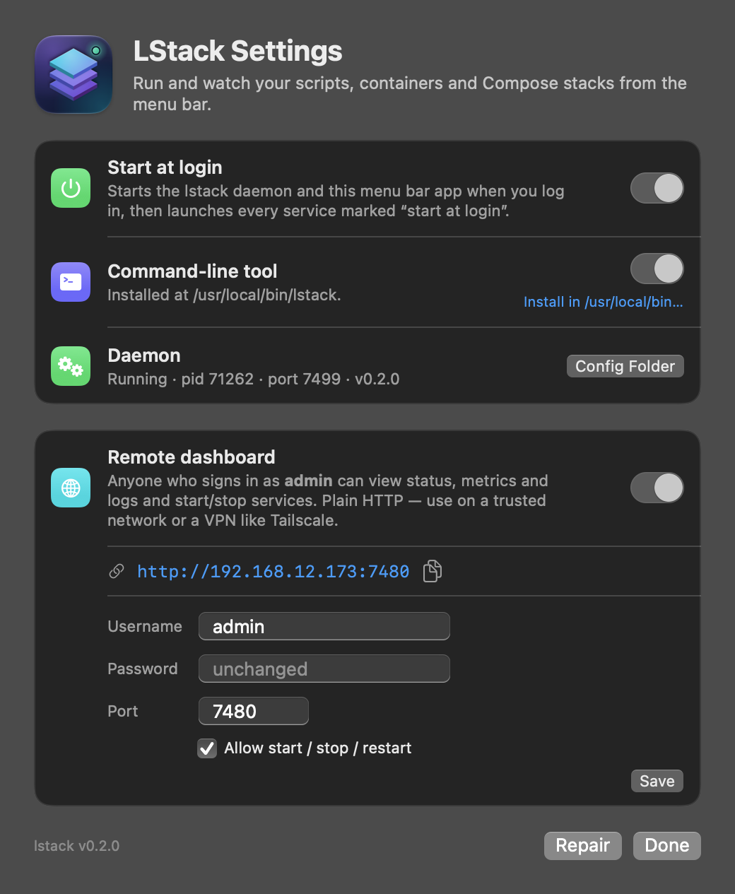
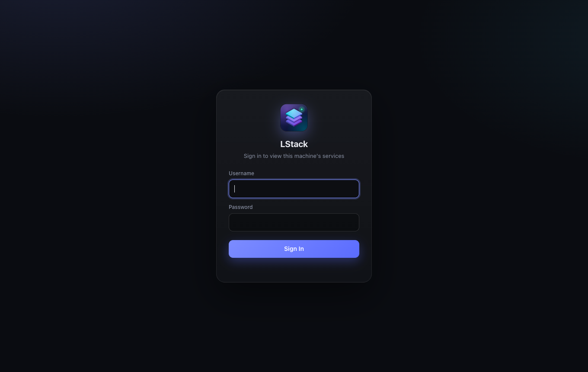

<p align="center">
  
</p>

<h1 align="center">LStack</h1>

<p align="center">
  A PM2-style manager for your <b>local stack</b>: shell scripts, Docker containers and Docker Compose stacks (Kubernetes is planned).<br>
  It has a native <b>macOS menu bar app</b>, an <b>htop-style terminal UI</b> and an optional <b>remote web dashboard</b>.
</p>

<p align="center">
  <a href="https://github.com/jhicken/localstack/releases/latest"><b>⬇ Download the latest release</b></a>
</p>

<p align="center">
  
  &nbsp;
  
</p>

- Starts the services you mark as **startup items** when you log in
- Shows live **health**, **CPU**, **memory** and **network** for each service, with history kept for 7 days
- Lets you watch **live logs** and interact: type into a script's stdin, or `docker exec` into a container
- Restarts crashed services with exponential backoff
- Optional password-protected **web dashboard**, so you can check on the machine from another computer
- Plain YAML config under `~/.localstack/`

> The CLI is named `lstack` so it doesn't collide with the LocalStack (AWS emulator) CLI.

## Screenshots

| Terminal UI (`lstack top`) | Remote web dashboard |
|---|---|
|  |  |

| Settings | Remote sign-in |
|---|---|
|  |  |

## Architecture

```
            ┌────────────────────────┐        ┌──────────────────────┐
            │  LStack.app (SwiftUI)  │        │  lstack CLI / TUI    │
            │  menu bar extra        │        │  (lstack top)        │
            └──────────┬─────────────┘        └──────────┬───────────┘
                       │   HTTP + Server-Sent Events     │
                       │   127.0.0.1:7317, bearer token  │
                       └───────────────┬─────────────────┘
                              ┌────────▼────────┐   launchd LaunchAgent
                              │  lstack daemon  │◄─ (dev.lstack.daemon,
                              │  (Rust, ~10 MB) │    KeepAlive, at login)
                              └──┬─────┬─────┬──┘
                    process grp  │     │     │  Docker Engine API / docker compose
                       ┌─────────▼┐ ┌──▼───┐ ┌▼────────┐
                       │ scripts  │ │docker│ │ compose │  …k8s (planned)
                       └──────────┘ └──────┘ └─────────┘
```

All state lives in `~/.localstack` (override with `LSTACK_HOME`):

| Path | Purpose |
|---|---|
| `services/<name>.yaml` | one file per service (edit by hand + `lstack reload`) |
| `logs/<name>.log` | combined stdout/stderr, rotated at 10 MB |
| `metrics.db` | SQLite resource history (7-day retention) |
| `daemon.json` | pid / port / auth token of the running daemon (mode 0600) |
| `remote.json` | remote dashboard settings and password hash (mode 0600) |

## Install

Download `LStack-<version>-arm64.dmg` from **[Releases](https://github.com/jhicken/localstack/releases/latest)**.

LStack ships as **one app**. `LStack.app` contains the SwiftUI menu bar app and a single ~3 MB Rust binary (`Contents/Helpers/lstack`). That binary is the daemon, the CLI and the TUI.

1. Open `LStack-<version>-arm64.dmg` and drag **LStack** to Applications. Or build it yourself (see Development).
2. Launch it. A **Welcome** window offers to:
   - **Start at login**: writes LaunchAgents for the daemon (`KeepAlive`) and the menu bar app.
   - **Install the `lstack` command**: symlinks the bundled binary into `/usr/local/bin` if that is writable, otherwise `~/.local/bin`. If needed it adds that directory to `PATH` in `~/.zprofile`. An admin option links into `/usr/local/bin`.

   You can reopen this window later from the ⚙ **Settings** button in the popover.

**Updating.** Quit LStack, replace the app in Applications and open it again. The background service (daemon) keeps running across app restarts, so if it is older than the new app, LStack asks whether to restart it. Choose **Later** and a banner in the menu offers it again. Restarting stops scripts LStack started; autostart ones start again and containers keep running. From a terminal: `lstack daemon restart`. The CLI also warns when it talks to an out-of-date daemon.

You can do the same from a terminal:

```sh
/Applications/LStack.app/Contents/Helpers/lstack setup     # CLI + login items
lstack setup status [--json]                               # what's installed / running
lstack setup repair                                        # re-point links after moving/updating the app
lstack setup uninstall                                     # remove login items + CLI link
```

On every launch the app runs `setup repair --quiet`, so moving or replacing `LStack.app` keeps the CLI link and LaunchAgents correct. No Node, Bun or other runtime is needed.

## Usage

```sh
lstack add api -a -c ~/code/api -- npm run dev                         # script, start at login
lstack add db -t docker --image postgres:16 -p 5432:5432 -e POSTGRES_PASSWORD=dev -a
lstack add stack -t compose --file ~/code/app/docker-compose.yml -a
lstack add web --health-url http://localhost:3000/health -- npm start
lstack add app -a -- 'cd ~/code/app && PORT=3000 bun run dev'        # cd/env are split out automatically

lstack                 # htop-style dashboard (↑↓ select, s/x/r start/stop/restart,
                       #   a toggle autostart, l logs, i type to stdin, e shell, ? help)
lstack ls              # table of services
lstack logs api -f     # follow logs
lstack attach api      # follow logs + send input to the process
lstack exec db psql -U postgres
lstack metrics api --range 24h
lstack enable api / lstack disable api
lstack rm api
lstack terminal iterm  # app used by Dashboard/Attach: terminal | iterm | cmux | ghostty
lstack ps              # other busy processes (over the CPU / memory / network thresholds)
```

The menu bar footer has two dashboard buttons: **Terminal** opens `lstack top` in your terminal app, and **Web** opens the web dashboard in your browser. Web appears only when the web dashboard is on.

Run `lstack help` for everything.

## Web dashboard

LStack can serve a small web dashboard. It shows services, health, CPU and memory history, live logs, and a whole-machine view per machine: each machine has a **Machine** section with a Load row (CPU and memory sparklines) above its busiest processes; click the Load row for CPU and memory charts covering the last 15 minutes, with LStack's share highlighted, plus the full process list. Machine groups and Machine sections fold away with a click, and the dashboard remembers which ones are folded. It is **off by default**. Turn it on from **Settings → Web dashboard** in the app, or from the CLI.

You choose who can open it: **this Mac only** (the listener binds to 127.0.0.1, and other devices get 403), or **other devices too**. Sharing with other Macs is a separate switch on its own encrypted link port (see [Other machines](#other-machines)), so you can use the dashboard locally without exposing it, or share with paired Macs while the dashboard stays off.

```sh
lstack remote on --local            # asks for a password the first time; http://127.0.0.1:7380
lstack remote web network           # let other devices open it too (listens on 0.0.0.0:7380)
lstack remote web local             # back to this Mac only
lstack remote on --port 8080 --user jeff --read-only
lstack remote passwd                # change the password (signs everyone out)
lstack remote status                # shows the URLs to open, e.g. http://192.168.1.20:7380
lstack remote 2fa on                # two-factor sign-in: scan the QR, enter a code to confirm
lstack remote 2fa off
lstack remote off                   # dashboard off (sharing is unaffected)
echo "$PW" | lstack remote on --password-stdin   # non-interactive
```

Then open `http://127.0.0.1:7380` (or `http://<this-mac>:7380` from another device) and sign in. Configs from before the split keep their behavior: the dashboard stays open to other devices and sharing stays on if the dashboard was on.

**Two-factor sign-in (TOTP).** Run `lstack remote 2fa on`, or use **Settings → Web dashboard → Two-factor → Set Up…**, then scan the QR code with 1Password, Google Authenticator, Authy or a similar app. After that, the sign-in page also asks for a 6-digit code. A code can be used only once, and the clock may be off by ±30 s.

- **Separate from the local API.** The daemon's own API stays on 127.0.0.1. The remote server is a second listener that exposes a read-mostly subset of it.
- **Accounts.** There is one account. The password is stored as a PBKDF2-SHA256 hash (120k rounds) in `remote.json`.
- **Sessions.** Sessions are HttpOnly, SameSite=Strict cookies that expire after 12 hours. Changing credentials or turning the server off ends every session and closes open log streams.
- **Login throttling.** Each failed login is delayed. After 5 failures from one IP, that IP is locked out for 5 minutes.
- **Controls.** Start/stop/restart buttons appear only when **Allow start / stop / restart** is enabled (`--allow-control`, the default). Use `--read-only` for view-only access.
- **Secrets.** Environment variable values are redacted (`••••`). Responses send a strict CSP, `X-Frame-Options: DENY` and CSRF header checks.
- **Plain HTTP.** Use it on a trusted network, or over a VPN such as Tailscale. macOS may ask you once to allow incoming connections.

## Secrets

LStack has a write-only secret store for tokens and passwords that your scripts need. Once you store a value, nothing can read it back: no API, no CLI command and no UI shows it. Each service gets only the secrets you give it, as environment variables.

```sh
lstack secret set GITHUB_TOKEN          # hidden prompt (or: … --stdin)
lstack secret ls                        # names, when they were set, which services use them
lstack secret rm GITHUB_TOKEN
lstack secret rotate-key                # re-encrypt everything under a new key
```

```yaml
secrets: [GITHUB_TOKEN, NPM_TOKEN]       # env var = secret name
secrets: { GH_TOKEN: GITHUB_TOKEN }      # or rename: ENV_VAR: SECRET_NAME
```

In the app, use **Settings → Secrets** to add, replace or delete secrets and to choose which services get each one.

- **At rest.** Secrets are encrypted with ChaCha20-Poly1305 in `secrets.enc`. The 256-bit key is never stored whole. It is split into two XOR shares: one is a Keychain item (`dev.lstack.secrets`, created via `/usr/bin/security` so app updates don't cause new prompts), the other a `0600` file. The daemon reads the Keychain once at boot and keeps the key only in memory, zeroed when dropped. If the Keychain is locked, the store stays locked: services that need secrets fail with a clear error, and `lstack secret unlock` (or **Unlock** in Settings) retries.
- **Logs are scrubbed.** Every secret value, plus its base64, URL-encoded and hex forms, is replaced with `••••[NAME]`. This applies to log files, live streams, the TUI and web views, crash messages, heartbeat `/fail` bodies, logs sent to other machines and `lstack exec` sessions. The daemon runs `docker exec` on a pseudo-terminal and scrubs the output before it reaches your terminal. Existing log files are scrubbed again when you add a secret.
- **Only on this Mac.** Secrets can't be set or read over the remote dashboard or by other machines.
- **Limitations.**
  - Docker stores container env, so anyone with Docker access can see it via `docker inspect`. A container keeps its old env until it is recreated.
  - A secret embedded in a larger string and then base64-encoded isn't scrubbed.
  - In `lstack exec`, a secret printed one character at a time can show its first two characters before the rest is masked, and any of it can show if the pauses are longer than 0.3 s. Running `docker exec` directly bypasses LStack entirely.

## Service URLs

When a service starts a web server, LStack finds its listening TCP ports (for scripts, any process in the service's process tree; for containers, their published ports). Each one becomes a clickable link: chips in the menu bar, `o` in `lstack top`, a URL column in `lstack ls`, and links in the web dashboard. To add your own links or label them:

```yaml
urls:
  - http://localhost:3000
  - { url: http://localhost:3000/admin, label: Admin }
detectUrls: false        # show only the urls above
```

On other machines, `localhost` is rewritten to that machine's address. Ports bound only to 127.0.0.1 are marked **local only**, because they usually can't be reached from another machine.

## Heartbeats (healthchecks.io)

LStack can ping [healthchecks.io](https://healthchecks.io), or any compatible server such as a self-hosted Healthchecks, so you get alerted when a service or the whole Mac goes down.

```sh
lstack heartbeat key                                  # project ping key (stored in the secret store)
lstack heartbeat set api                              # pings <server>/<key>/api (check created on first ping)
lstack heartbeat set api --url https://hc-ping.com/<uuid> --interval 120
lstack heartbeat machine mac-mini                     # ping while this Mac and LStack are up
lstack heartbeat test api
lstack heartbeat                                      # last ping per service
```

```yaml
heartbeat:
  url: https://hc-ping.com/<uuid>   # or `slug: api` with a ping key; default slug = service name
  interval: 60                      # success ping while running and healthy
  start: true                       # /start when it (re)starts
  fail: true                        # /fail on crash, unhealthy or giving up
  logs: true                        # attach the last 20 (scrubbed) log lines to /fail
```

You can also manage this in **Settings → Monitoring**, where you set the ping key and server, turn on the machine heartbeat, and use a one-click per-service toggle and Test button. The last ping result appears in each service's details in every interface. Ping URLs are hidden from the remote dashboard.

## Other machines

A Mac can watch other Macs that run LStack. Their services and busy processes then appear, grouped by machine, in the menu bar, `lstack ls`, `lstack top` and the web dashboard. In the menu bar, each other Mac shows a Load row with CPU and memory sparklines above its busy processes. Machine sections can be collapsed, and the menu bar remembers which ones are.

Each paired Mac's web servers are also **forwarded to this Mac automatically**. A service on the other Mac at `127.0.0.1:3000` shows up here as `http://localhost:3000`, marked 🔒 "via studio" in every interface. Everything goes through one end-to-end encrypted link per Mac.

1. On the Mac to be watched, set a dashboard login (`lstack remote on --local`, or **Settings → General → Web dashboard**). Turn on 2FA if you can. Then turn on sharing (`lstack remote share on`, or **Settings → Machines → Share this Mac**) and run `lstack remote pair` or click **Show Pairing Code**. You get a one-time code, valid for 10 minutes. The web dashboard itself can stay off.
2. On your Mac, run `lstack machine pair studio.local --code XXXX-XXXX`, or use **Settings → Machines**. It asks for the other Mac's dashboard username, password and 2FA code. Both Macs then show the same four-word phrase, which you can compare if you want to be sure.

```sh
lstack machine ls                 # status, address, access granted to you
lstack machine id                 # this install's key fingerprint; `machine rekey` replaces it
lstack ls --machine studio        # or --local
lstack logs api@studio -f         # name@machine works for logs/show/start/stop/restart/metrics
lstack ps --machine studio
lstack forwards                   # paired Macs' services forwarded to localhost
lstack forwards pause web@studio  # or resume
lstack machine rename studio mini
lstack machine rm mini

# on the watched Mac
lstack remote peers               # paired Macs, their access and link state
lstack remote grant laptop control --tunnel web,api   # or no-control, --tunnel all|none
lstack remote revoke laptop       # unpair now: its link and tunnels drop
lstack remote activity            # links, pairings, tunnels and refusals
```

- **Access per Mac.** A new pairing can view and tunnel to all services but can't control them. On the watched Mac, change this per paired Mac: start/stop/restart, and tunnels to all services, none, or a list (Settings → Machines → Share this Mac, or `lstack remote grant`). Changes apply at once: the link reconnects with the new grants. Turning sharing off drops every link; pairings are kept.
- **Forwards.** Forwards appear only for granted services and only for ports that service is listening on *right now*. The watched Mac checks this again for every connection, so another program sitting on a stopped service's port is refused. It only ever connects to its own loopback. On this Mac, forwards listen only on 127.0.0.1/::1 and keep the same port number when it's free (otherwise a remembered fallback, saved in `forwards.json`). Each connection must come from a process owned by your macOS user.
- **No secrets cross.** Secret values are never sent, env values and ping URLs are redacted, and logs are scrubbed on the watched Mac before they're sent.
- **Upgrading from an older LStack.** Old pairings used bearer tokens over plain HTTP and are no longer accepted. They show as **pair again**: get a new code on the other Mac and pair again; the name is kept.

### Security model

Each LStack install has its own X25519 key pair. The private key is kept in the secret store (encrypted, split between the Keychain and a 0600 file) and never leaves the Mac. Pairing ties two installs together; after that, only those two keys can talk.

- **Pairing.** The two Macs run SPAKE2 over the one-time code, so the code never crosses the network and an attacker gets one online guess. Three wrong tries burn it. The dashboard login and 2FA code go only inside that encrypted session and must also be right. Then both Macs swap and pin each other's public key.
- **The link.** One TCP connection per paired Mac to the watched Mac's link port (default **7381**, `--link-port`), using **Noise IK** (X25519, ChaCha20-Poly1305, BLAKE2s). It's mutually authenticated by the pinned keys and forward-secret. Status, logs, control, `exec` and tunnels are typed streams multiplexed over it, and each stream is checked against that Mac's grants when it opens. The link port speaks nothing but Noise. Unknown keys are refused and logged, and failed pairings count toward a per-address lockout.
- **No shared secrets stored.** `peers.json` and `remote.json` hold only public keys, names and grants, so copying them gives nothing.

| Attacker | Result |
|---|---|
| Watches the network | Sees only Noise ciphertext; the pairing code and login are never sent in the clear |
| Man-in-the-middle during pairing | One guess at the code, then it's burned |
| Man-in-the-middle later | Handshake fails without both pinned private keys |
| Copies `peers.json` / `remote.json` | Gets public keys only |
| Knows the dashboard password only | Can't pair without a live code from the other Mac's screen |
| Sees the pairing code only | Can't pair without the password (and 2FA) |
| Another macOS user on your Mac | Their connections to forwarded ports are refused |
| Another app running as you | Can use forwards, just like your browser can (same trust as your user) |
| A compromised paired Mac | Limited to its grants: granted services' own ports on the loopback; audited and revocable |

Not supported: reverse tunnels, UDP, and relays or NAT traversal. Use the LAN or a VPN such as Tailscale to reach the link port.

**Future: screen sharing.** The link's typed streams are built so that screen sharing can be added later as two more stream kinds, each with its own grant and a consent prompt on the shared Mac: `screen` (ScreenCaptureKit capture, VideoToolbox H.264/HEVC frames) and `input` (CGEvent injection; needs Accessibility). Those frames would use the same Noise link with no extra crypto. This isn't implemented yet.

## Busy processes

Under each machine's services, LStack lists other processes that cross a threshold. The defaults are CPU over 10% of a core, memory over 10% of RAM, or network over 1 MB/s, with at most 15 per machine. LStack services always show, whatever their usage. You can change the thresholds in **Settings → Monitoring**, or with `PUT /api/settings {"processes": {…}}`. The same list is available from `lstack ps` and `GET /api/processes`. Only your own processes' network use and ports can be read without root.

### Shell environment

Scripts run the way they would in a new Terminal tab. That matters because the daemon is started by launchd with a bare environment, so tools like `bun`, `nvm`, Homebrew binaries or the 1Password `op` CLI would otherwise be missing.

- Each script runs in your **login shell** (`$SHELL -l`, so `~/.zprofile` and Homebrew's `shellenv` apply).
- Before the command runs, the shell **sources** the files in `source:`. The default is your shell's rc file (`~/.zshrc` for zsh, `~/.bashrc` for bash).
- The command is `eval`ed after sourcing, so aliases and functions from those files work.
- Use `source: [...]` to replace the list, for example `[~/.zshrc, .venv/bin/activate]`. Use `source: []`, or `lstack add --no-source`, to skip shell config.
- From the CLI, `-s/--source <file>` adds files. In the app, use the **Shell environment → Source files** field.

**Command splitting.** When you add a script, these leading setup steps are moved out of the command into their own fields:

| Leading step | Moved to |
|---|---|
| `cd <dir> &&` | `cwd` |
| `FOO=bar`, `export FOO=bar &&` | `env` |
| `source <file> &&`, `. <file> &&` | `source` |

```sh
lstack add web -- 'cd ~/code/web && export PORT=3000 && source .env && bun run dev'
# ↳ split out cwd ~/code/web · env PORT · source ~/code/web/.env
#   command: bun run dev
```

- **What isn't split.** Anything that needs runtime expansion (`$VAR`, `$(…)`, globs) is left alone, as is everything after a pipe or subshell. Pass `--no-split` to keep the command exactly as typed.
- **In the app.** The Add Service window shows a **Split Out** suggestion as you type.

**1Password CLI (`op`) and other tools that read app data.** macOS privacy rules apply to scripts launched by the LStack daemon. Without permission, `op` can't read 1Password's settings, so it reports "No accounts configured" and never shows the Touch ID prompt. To fix this, grant **Full Disk Access** to LStack. Click **Grant Access…** in the menu bar banner (or **Settings → Full Disk Access → Grant…**). It opens the matching System Settings pane; turn on **LStack** (if it isn't listed, click + and choose LStack from Applications). The background daemon runs from inside the app bundle, so it's covered by the app's grant; there's no separate helper to add. LStack detects the grant and offers to restart your scripts. If it stops working after an update, remove the entry and add it again.

### Service YAML

```yaml
# ~/.localstack/services/api.yaml
name: api
type: process            # process | docker | compose | k8s
command: npm run dev
cwd: ~/code/api
env: { PORT: "3000" }
source: [~/.zshrc, .env] # sourced first (default: your shell rc); [] = none
autostart: true          # start at login / daemon boot
restart: on-failure      # always | on-failure | never
maxRestarts: 10
healthcheck: { type: http, url: http://localhost:3000/health, interval: 10 }
```

```yaml
name: db
type: docker
image: postgres:16       # or `container: existing-name` to manage an existing container
ports: ["5432:5432"]
volumes: ["pgdata:/var/lib/postgresql/data"]
env: { POSTGRES_PASSWORD: dev }
autostart: true
```

```yaml
name: stack
type: compose
composeFile: ~/code/app/docker-compose.yml
project: app
autostart: true
```

## Behavior notes

- Scripts run in their own process group under `$SHELL -l` (see Shell environment). Stopping sends SIGTERM, then SIGKILL after 8 s.
- When the daemon exits, it stops scripts but **leaves containers running**. On restart it re-adopts them, and it reaps orphaned script process groups if the daemon was killed.
- At login, the daemon waits up to 10 minutes for Docker Desktop before it starts container services.
- **Machine load.** The top of the menu bar panel shows whole-Mac CPU and memory with ~15 minutes of sparkline history. Each is split into **LStack** (your services) and **Other** (every other app), so you can tell when the machine itself is overloaded. The same data is at `GET /api/system`. Machine CPU is a share of all cores, while per-service CPU is a share of one core, as in Activity Monitor.
- **Crash loops.** Crashed scripts restart with exponential backoff (1 s → 30 s, up to `maxRestarts`). While a script waits to restart, the menu bar shows **RESTART IN Ns** with a red stop button. `lstack ls` and `lstack top` show `restarting Ns`. Stopping it cancels the pending restart, and stop waits for a start that's already in progress.
- **Terminal app.** Dashboard, Attach and Shell open in the app chosen under **Settings → Terminal app** (or `lstack terminal <id>`): Terminal, iTerm, cmux or Ghostty. macOS asks once to allow LStack to control iTerm or Terminal.
- **cmux.** By default, cmux only accepts commands from processes started inside cmux, so the daemon gets "Access denied". When that happens, the menu bar offers **Allow LStack** or **Use Terminal**. You'll find the same switch under **Settings → cmux access**, and in the CLI as `lstack terminal cmux --fix`. Allowing it backs up `~/.config/cmux/cmux.json`, switches `automation.socketControlMode` to `password` with a random password kept in LStack's secret store, and reloads cmux. You can change or undo this anytime in cmux's settings.
- The API binds to 127.0.0.1 only and requires the token in `daemon.json`.

## Development

Requires Rust ≥ 1.80 and Xcode / Swift 5.10+.

```sh
cargo run -- ls                     # run the CLI from source
cargo test                          # unit + end-to-end daemon test (sandboxed)
LSTACK_HOME=/tmp/lt LSTACK_PORT=7499 cargo run -- daemon run   # isolated daemon

macos/build.sh                      # → dist/LStack.app, .zip and .dmg
macos/build.sh --install            # …and copy to /Applications + launch
SIGN_IDENTITY="Developer ID Application: …" macos/build.sh      # real signing (default: ad-hoc)

LSTACK_SNAPSHOT=out.png dist/LStack.app/Contents/MacOS/LStack   # render the popover to a PNG
```

Layout: `src/daemon/` (supervisor, drivers, Docker Engine API client, metrics store, HTTP/SSE server), `src/cli.rs`, `src/tui.rs` (ratatui), `src/setup.rs` + `src/launchd.rs` (self-install), `macos/` (SwiftUI app).

Layout also includes `src/daemon/remote.rs` + `src/daemon/web/` (remote dashboard, embedded into the binary) and `macos/icon/` (the app icon is drawn in code: `macos/icon/build-icons.sh` regenerates `AppIcon.icns` and the web icon).

## Releases

Releases are published at **[github.com/jhicken/localstack/releases](https://github.com/jhicken/localstack/releases)**. Each release includes:

- `LStack-<version>-arm64.dmg`: open it and drag LStack to Applications.
- `LStack-<version>-arm64.zip`
- `LStack-<version>-arm64.sha256`: checksums for both files.

To cut a release, commit your work, then run:

```sh
macos/release.sh                  # patch bump: 0.3.3 → 0.3.4 (or: minor | major | 1.2.3 | current)
macos/release.sh minor --dry-run  # run the checks and show the new version, change nothing
macos/release.sh --draft          # publish the release as a draft
macos/release.sh current --skip-build  # retry a failed upload of what's already in dist/
```

Everything runs on this Mac; GitHub Actions isn't used. The script requires a clean tree that is up to date with origin and the GitHub CLI (`gh auth login`). It runs `cargo test` and `cargo clippy -D warnings`, bumps `version` in `Cargo.toml` and `Cargo.lock`, commits `chore: release vX.Y.Z` and tags it. Then it builds the dmg, zip and checksums with `macos/build.sh`, pushes the branch and tag together, and creates the GitHub release with those files (or replaces the assets if it already exists). If the checks or the build fail, it removes the bump commit and tag, leaving the tree as it was.

- **Building on GitHub instead.** `macos/release.sh --ci` pushes without building and starts the release workflow (`.github/workflows/release.yml`), which builds on a macOS runner. The workflow only runs when started this way or from the Actions tab (for example, to rebuild an existing tag); pushing a tag doesn't trigger it.
- **Code signing.** Builds are ad-hoc signed. The first time you open a downloaded copy, right-click the app and choose **Open**.

See [docs/PLAN.md](docs/PLAN.md) for the roadmap.
